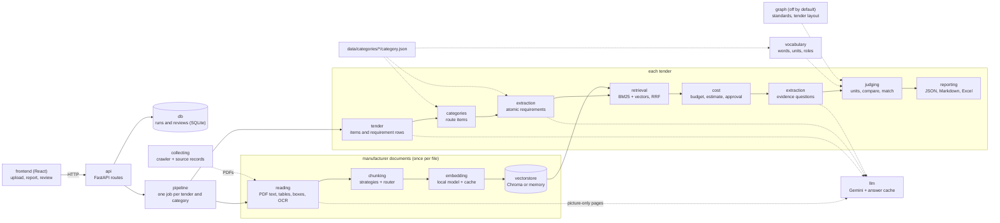
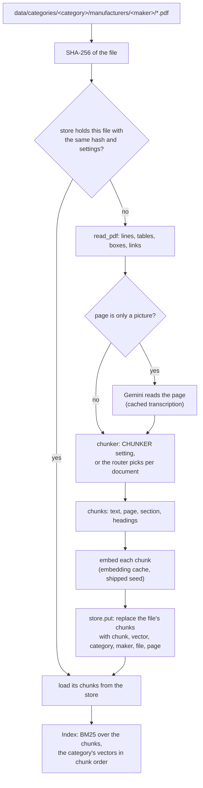
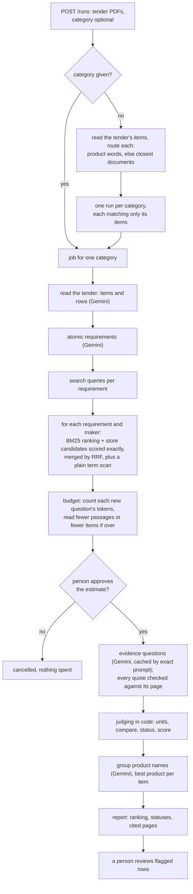

# Architecture

The tender-matcher takes a government tender (GeM bid PDFs) and a set of manufacturers' catalogues, and reports, for every requirement of the tender and every manufacturer, whether the manufacturer's documents show the requirement is met, with the page that says so.

One rule shapes the whole design: **the language model only reads; plain code judges.** Gemini turns text into structured facts (the tender's requirements, what a catalogue passage states). Comparing values, scoring and ranking are ordinary, tested Python, and every quote the model gives is checked against the page it came from.

## Overview

| Package (`backend/app/`) | What it does |
|---|---|
| `api`, `db` | the web service and the stored runs and review decisions |
| `pipeline` | the whole job for one tender: `gather` (read, search, ask), `score`, `build_report`; `runner` runs jobs one at a time and splits a mixed tender into one run per category |
| `tender` | finds the tender's PDFs and reads its items and requirement rows (with the model) |
| `categories` | each category's own words and rules (`category.json`), and routing each tender item to a category |
| `reading` | PyMuPDF: lines with position and font, tables, flowchart boxes and the lines between them; picture-only pages are read by the model |
| `chunking` | cuts documents into passages: five strategies behind one interface, chosen by `CHUNKER` or per document by the router |
| `embedding` | local embeddings (fastembed, `bge-small-en-v1.5`), cached per text |
| `vectorstore` | where chunks and vectors are kept: Chroma (on disk) or memory, behind one interface; `ingest` reads each file once |
| `retrieval` | search queries for a requirement, BM25 keyword search, meaning search through the store, rank fusion (RRF) |
| `extraction` | the model calls: tender rows to atomic requirements, passages to evidence, product names grouped |
| `judging` | plain code: units (Pint), comparisons, the match status and score per requirement |
| `cost` | token counting, the per-tender budget, the estimate a person approves before money is spent |
| `llm` | the Gemini client, the answer cache, retries, parallel calls, the call limit |
| `reporting` | the report and its Markdown and Excel forms; coverage and audit tables |
| `vocabulary` | shared words, abbreviations, number words, requirement roles |
| `evaluation` | answer keys and scoring against them |
| `collecting` | the catalogue crawler and the record of where each document came from |
| `graph` | a small knowledge graph: standards that are one document under several names or that documents name together, and a tender's items, shared rows and requirements; off by default |

## Ingest path: a manufacturer document becomes searchable

The settings in the key are the chunking strategy, whether pictures are read, and a fingerprint of the reading and chunking code, so changing any of them re-reads the file instead of serving stale chunks.

## Query path: a tender becomes a report

## Design decisions and their trade-offs

**The model reads, code judges.** Every number in a report comes from code that can be tested and explained, and every quote is checked against the page it came from. The cost is more code than "ask the model for a verdict", and the code only understands the units and wordings it was taught (`backend/config/`, `category.json`).

**Saved answers are keyed by the exact prompt.** An answer is saved under a hash of the model, its settings, the instructions and the question. That makes re-running a tender free and repeatable, and it is why so much below is about keeping prompts byte-identical. Any change to a prompt, a passage's text or the passages' order makes that question new, so it costs money again. The shipped demo answers (`data/demo_cache`) only work while the defaults stay as they are.

**The default chunker is kept for cache reasons.** Five chunking strategies exist, and on the free retrieval checks `structure` and `auto` did as well as or slightly better than the original `table_rows` (phase 2 in `docs/CHANGES.md`). But a different chunker gives different passages, so every question would be new. The original stays the default until a paid run shows another one gives better final answers.

**Exact scoring instead of approximate search.** Chroma finds nearest vectors approximately, and its arithmetic differs from NumPy's in the last digits. That reordered two passages in 3 of 1,273 questions. So Chroma proposes candidates and the index scores them itself with the same matrix product as the first version, from vectors stored unchanged (inner-product mode). Every question is now identical. The price is that Chroma's speed-up is not used. The rank fusion needs a manufacturer's whole meaning ranking, so every chunk of that manufacturer is scored, which at about 2,000 chunks per category is instant. What Chroma gives is storage between starts, filters by category, maker, file and page, and reading each document once. At a much larger collection, exact scoring would have to give way to approximate search, and the cost would be new questions.

**One process per Chroma folder.** The embedded Chroma store is safe for one process. The app is one process (jobs run as threads, and writes to the store go one at a time), but running a script on the same folder while the server runs can break the store's index; this happened once while measuring. The fix is to delete the folder, which is only a cache. Running several app processes would need Chroma as a separate server.

**One shared tender-reading prompt.** Each category can add rules for reading tender rows (`extraction_rules` in `category.json`), and every category's rules are in every prompt, so the prompt does not depend on which items a tender has. The trade-off: adding a rule to any category changes the prompt for every tender, so all their saved answers stop matching. A test pins the prompt to the text the saved answers were made with.

**One run per category.** A tender that buys pumps and valves becomes two runs, each a normal one-category report with its own ranking. Comparing a pump maker with a valve maker would mean nothing, and this kept the scoring and report code unchanged. The price is that a mixed tender is read as several reports, not one.

**Items are routed without the model.** Product words first, then the categories' own documents by meaning. It is free and explainable, and it put all 11 labelled items in the right category, but no labelled tender mixes categories yet.

**Money is only spent after a person agrees.** Before any evidence question is asked, every new question is counted and priced, the budget may read fewer passages or fewer items, and the web page waits for Proceed. Token counts are characters / 4 by default; `TOKEN_COUNTER=gemini` uses Gemini's exact count, which is a request to Google and so stays under the same call limit.

**Settings default to what the saved answers were made with.** The model (`LLM_MODEL`), thinking level (`LLM_THINKING`) and temperature (`LLM_TEMPERATURE`) are settings. Temperature stays 0 by default even though Google advises leaving Gemini 3 models at 1.0, because every saved answer was made at 0. Changing any of them changes the cache key, so every question is new.

**A knowledge graph that only advises.** The standards graph is built by a script from the catalogues and the saved tender readings, and saved as JSON that a person can read and correct. Its two kinds of link are not equally sure. One standard under several names follows from how adopted standards are named, so it may count as a match. Two standards named together ("API 600 / BS 1873") are often not equivalent, so that link can only send a requirement to a person, and only when the tender says it accepts an equivalent. The whole graph is off by default; on the two labelled tenders, switching it on changed no outcome.

**What needs paid runs.** Whether another chunker, temperature, model or the exact token counter changes the results can only be measured by asking the model again. Each such check, what it would measure and how to run it is listed in [`NEEDS_PAID_RUN.md`](NEEDS_PAID_RUN.md). Phase 7 adds cost estimates to each entry.
