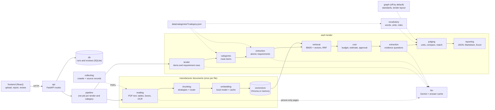
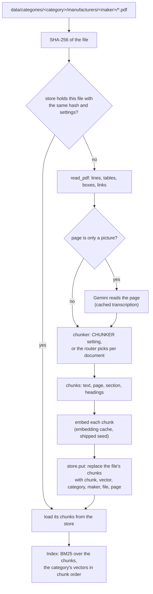
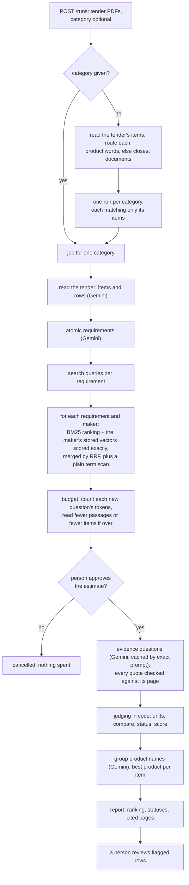

# Architecture

The tender-matcher takes a government tender (GeM bid PDFs) and a set of manufacturers' catalogues, and reports, for every requirement of the tender and every manufacturer, whether the manufacturer's documents show the requirement is met, with the page that says so.

One rule shapes the whole design: **the language model only reads; plain code judges.** Gemini turns text into structured facts (the tender's requirements, what a catalogue passage states). Comparing values, scoring and ranking are ordinary, tested Python, and every quote the model gives is checked against the page it came from.

## Overview

| Package (`backend/app/`) | What it does |
|---|---|
| `api`, `db` | the web service and the stored runs and review decisions |
| `pipeline` | the whole job for one tender: `gather` (read, search, ask), `score`, `build_report`; `runner` runs jobs one at a time and splits a mixed tender into one run per category |
| `tender` | finds the tender's PDFs and reads its items and requirement rows (with the model) |
| `categories` | each category's own words and rules (`category.json`), and routing each tender item to a category |
| `reading` | PyMuPDF: lines with position and font, tables, flowchart boxes and the lines between them; picture-only pages are read by the model |
| `chunking` | cuts documents into passages: five strategies behind one interface, chosen by `CHUNKER` or per document by the router |
| `embedding` | local embeddings (fastembed, `bge-small-en-v1.5`), cached per text |
| `vectorstore` | where chunks and vectors are kept: Chroma (on disk) or memory, behind one interface; `ingest` reads each file once |
| `retrieval` | search queries for a requirement, BM25 keyword search, meaning search through the store, rank fusion (RRF) |
| `extraction` | the model calls: tender rows to atomic requirements, passages to evidence, product names grouped |
| `judging` | plain code: units (Pint), comparisons, the match status and score per requirement |
| `cost` | token counting, the per-tender budget, the estimate a person approves before money is spent |
| `llm` | the Gemini client, the answer cache, retries, parallel calls, the call limit |
| `reporting` | the report and its Markdown and Excel forms; coverage and audit tables |
| `vocabulary` | shared words, abbreviations, number words, requirement roles |
| `evaluation` | answer keys and scoring against them |
| `collecting` | the catalogue crawler and the record of where each document came from |
| `graph` | a small knowledge graph: standards that are one document under several names or that documents name together, and a tender's items, shared rows and requirements; off by default |

## Ingest path: a manufacturer document becomes searchable

The settings in the key are the chunking strategy, whether pictures are read, and a fingerprint of the reading and chunking code, so changing any of them re-reads the file instead of serving stale chunks.

## Query path: a tender becomes a report

## Design decisions and their trade-offs

**The model reads, code judges.** Every number in a report comes from code that can be tested and explained, and every quote is checked against the page it came from. The cost is more code than "ask the model for a verdict", and the code only understands the units and wordings it was taught (`backend/config/`, `category.json`).

**Saved answers are keyed by the exact prompt.** An answer is saved under a hash of the model, its settings, the instructions and the question. That makes re-running a tender free and repeatable, and it is why so much below is about keeping prompts byte-identical. Any change to a prompt, a passage's text or the passages' order makes that question new, so it costs money again. The shipped demo answers (`data/demo_cache`) only work while the defaults stay as they are.

**The default chunker is kept for cache reasons.** Five chunking strategies exist, and on the free retrieval checks `structure` and `auto` did as well as or slightly better than the original `table_rows` (phase 2 in `docs/CHANGES.md`). But a different chunker gives different passages, so every question would be new. The original stays the default until a paid run shows another one gives better final answers.

**Chroma stores and filters; similarity is scored exactly in the code.** What Chroma does here is keep the chunks and their vectors on disk between starts, so each document is read once, and return the chunks that match a filter (category, maker, file, page). Similarity is not Chroma's job: the index multiplies the stored vectors by the query with the same matrix product as the first version and ranks by that. The reason is order: Chroma's nearest-neighbour search (HNSW) is approximate, and its arithmetic differs from NumPy's in the last digits. That reordered two passages in 3 of 1,273 questions. With exact scoring in the code, every question is identical to the first version's.

**Chroma sometimes cannot read a store it has just written to.** Right after writes it can fail with "Error creating hnsw segment reader: Nothing found on disk". This happens with a nearest-neighbour query, and also when only the stored vectors are read, which the app does on every start. So not using the nearest-neighbour search did not remove it. What has been measured (with `scripts/diagnose/chroma_repro.py`, which uses Chroma alone):
- **Only on Windows so far.** With Chroma 1.5.9 on Windows 11 it failed within 5 to 175 attempts in every folder tried: the temp folder, the home folder and the project folder, none of them synced by OneDrive. On Linux (in the app's Docker image on the same machine, and on the owner's Linux machine) there was no error in 600 attempts each.
- **The data is on disk; the open client is stuck.** After the error, the same client keeps failing, even 36 seconds later. A newly opened client, or another process, reads the same store without error.

So when reading the stored vectors or the matching chunks fails with exactly this error, the store logs a warning, closes the client, opens a new one on the same folder and reads once more (`ChromaStore.reading`). Any other error is raised unchanged, and so is this one if the new client fails too. A retry that only waited did not help and was removed. With the reopen, the store tests passed 100 runs in a row and the full suite 30 in a row on Windows, where before the store tests failed about once in 20 to 47 runs; in 40 further runs a stuck client was reopened twice and both reads then succeeded. The reopen gives a fresh state only when no other client has the same folder open, which holds in the app (one client per folder). The cause inside Chroma has not been established. In the Docker image, which runs on Linux, it has not been seen.

The price is that Chroma's speed-up is not used. That costs nothing here: the rank fusion needs a manufacturer's whole meaning ranking anyway, and scoring all of a manufacturer's chunks (about 2,000 per category) takes a moment. Approximate search is for much larger collections, where scoring everything would be too slow. Using it there would mean accepting that some passages come in a slightly different order, and so some questions would be new.

**One process per Chroma folder.** The embedded Chroma store is safe for one process. The app is one process (jobs run as threads, and writes to the store go one at a time), but running a script on the same folder while the server runs can break the store's index; this happened once while measuring. The fix is to delete the folder, which is only a cache. Running several app processes would need Chroma as a separate server.

**One shared tender-reading prompt.** Each category can add rules for reading tender rows (`extraction_rules` in `category.json`), and every category's rules are in every prompt, so the prompt does not depend on which items a tender has. The trade-off: adding a rule to any category changes the prompt for every tender, so all their saved answers stop matching. A test pins the prompt to the text the saved answers were made with.

**At most 7 files in a folder, for code.** The rule applies to code, tests, scripts and config. Three places are exempt, on purpose:
- `frontend/`'s root config files (8), which tools expect at the root;
- the manufacturers' documents, such as `data/categories/valves/manufacturers/ksb/` with KSB's 8 valve catalogues. They are data: each folder holds one manufacturer's documents as published, and its folder and file names become the manufacturer and file of every chunk and appear in the questions sent to the model. Splitting a maker's folder would change those names, so the saved answers would no longer match;
- the shipped answers in `data/demo_cache/`. These are split into subfolders by the first two characters of each file's name (`data/demo_cache/3f/3f…json`, see `shipped_path` in `app/llm/llm_cache.py`). With 611 answers spread over the possible two-character names, most subfolders hold 1 to 4 files and two hold 8 and 9.

**One run per category.** A tender that buys pumps and valves becomes two runs, each a normal one-category report with its own ranking. Comparing a pump maker with a valve maker would mean nothing, and this kept the scoring and report code unchanged. The price is that a mixed tender is read as several reports, not one.

**Items are routed without the model.** Product words first, then the categories' own documents by meaning. It is free and explainable, and it put all 11 labelled items in the right category, but no labelled tender mixes categories yet.

**Money is only spent after a person agrees.** Before any evidence question is asked, every new question is counted and priced, the budget may read fewer passages or fewer items, and the web page waits for Proceed. Token counts are characters / 4 by default; `TOKEN_COUNTER=gemini` uses Gemini's exact count, which is a request to Google and so stays under the same call limit.

**Settings default to what the saved answers were made with.** The model (`LLM_MODEL`), thinking level (`LLM_THINKING`) and temperature (`LLM_TEMPERATURE`) are settings. Temperature stays 0 by default even though Google advises leaving Gemini 3 models at 1.0, because every saved answer was made at 0. Changing any of them changes the cache key, so every question is new.

**A knowledge graph that only advises.** The standards graph is built by a script from the catalogues and the saved tender readings, and saved as JSON that a person can read and correct. Its two kinds of link are not equally sure. One standard under several names follows from how adopted standards are named, so it may count as a match. Two standards named together ("API 600 / BS 1873") are often not equivalent, so that link can only send a requirement to a person, and only when the tender says it accepts an equivalent. The whole graph is off by default; on the two labelled tenders, switching it on changed no outcome.

**What needs paid runs.** Whether another chunker, temperature, model or the exact token counter changes the results can only be measured by asking the model again. Each such check, what it would measure and how to run it is listed in [`NEEDS_PAID_RUN.md`](NEEDS_PAID_RUN.md). Each is priced there, with a priority and a recommended first plan under ₹100.
